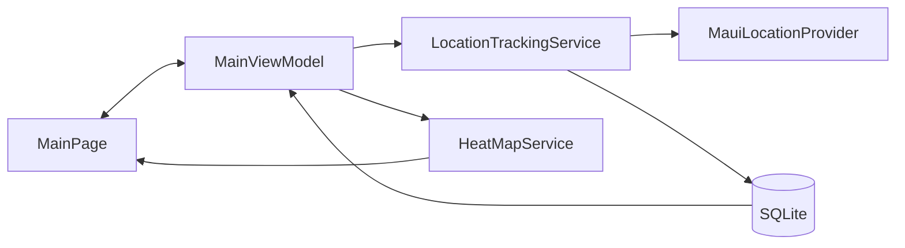

# Location Tracker - .NET MAUI

**Student:** Ashish Bhanudas Mahajan

**Course:** MSCS-533-A01 — Software Engineering and Multiplatform App Development

**University:** University of the Cumberlands

**Term:** Fall 2026 First Bi-Term

**Repository:** https://github.com/AshishM26/MSCS-533-Project_2_AM

Location Tracker records foreground device locations in a local SQLite database and displays their relative density as colored circles on a native .NET MAUI map. It implements the final software development project assignment in C#.

Build results and remaining device checks are recorded in [validation status](submission/VALIDATION.md).

## Features

- Start and stop foreground tracking; requests never overlap.
- An eight-second pause between location requests, with a 15-second GPS timeout.
- Local SQLite history that reloads on launch.
- Approximately 75-meter geographic grid cells with blue, amber, and red density circles.
- Sample count, latest reading time, accuracy, and actionable status messages.
- Center on the latest recorded location; enabled after the first saved sample.
- Confirm before clearing all stored history and overlays; stop tracking before clearing.
- Automatic cancellation when the app enters the background. Tracking must be restarted explicitly.
- Android and iOS targets, plus Mac Catalyst on macOS. Windows is omitted because the required native circle overlay behavior is not available there through the same MAUI Maps implementation.

## Technology and architecture

The solution uses stable .NET 10 (SDK pinned in `global.json`), MAUI Controls/Maps 10.0.100, and sqlite-net-pcl 1.11.285. It uses MAUI's built-in dependency injection and a small MVVM implementation rather than a separate application framework.

```text
LocationTracker.slnx
LocationTracker/                       MAUI application
  Views/MainPage.xaml                  Layout and compiled bindings
  Views/MainPage.xaml.cs               Native map rendering and dialogs
  ViewModels/MainViewModel.cs          State and commands
  ViewModels/AsyncCommand.cs           Awaited actions and double-tap prevention
  Services/MauiLocationProvider.cs     Device GPS and permission adapter
  Platforms/Android/AndroidManifest.xml
  Platforms/iOS/Info.plist
  Platforms/MacCatalyst/               Desktop Apple configuration
  MauiProgram.cs                       Dependency injection and UseMauiMaps()
LocationTracker.Core/                  Portable, tested C# logic
  Models/LocationRecord.cs
  Models/HeatMapCell.cs
  Data/LocationDatabase.cs
  Services/LocationTrackingService.cs
  Services/HeatMapService.cs
LocationTracker.Tests/                 xUnit logic and SQLite integration tests
scripts/                              Report generation and secret checks
submission/                           Word report, validation and checklist
```



The portable project keeps the model, persistence, sampling orchestration, and aggregation testable without requiring a simulator. The MAUI project supplies the real geolocation adapter and native `Circle` map elements.

## SQLite and privacy

`MauiProgram.cs` creates `LocationDatabase` with `FileSystem.AppDataDirectory/locations.db3`. Initialization is lazy, operations are asynchronous, and a semaphore serializes initialization and database access. The table records an auto-incrementing ID, latitude, longitude, UTC timestamp, and optional horizontal accuracy. Invalid coordinates are rejected.

History stays in the app's local storage, is not uploaded by this application, and can be deleted using **Clear History**. The SQLite file is not encrypted. Android application backup is disabled; Apple device backups are governed by the operating system. Native map providers use network services for map tiles and may process map requests. This app does not request background-location permission, log coordinates, or include analytics.

## Heat-map calculation

1. Reject invalid/nonfinite coordinates during aggregation.
2. Divide latitude into roughly 75-meter bands and adjust longitude cell width by the cosine of the band's latitude.
3. Count samples in each occupied cell and calculate its average latitude and circular mean longitude.
4. Divide each count by the largest cell count to obtain density in `(0, 1]`.
5. Draw one `Microsoft.Maui.Controls.Maps.Circle` per cell. Blue indicates density up to 0.33, amber up to 0.66, and red above 0.66. Radius and opacity also increase with density.
6. If there are more than 400 occupied cells, double grid size and regroup until the overlay limit is met. No saved samples are deleted or omitted by this step.

This is a discrete density visualization, not a continuous kernel-density raster. All cells can be red when their counts are equal; colors are relative to the densest cell in the current history. Adjacent points can lie on opposite grid boundaries. Stopping at a location produces denser cells, so the result approximates time spent where sampling succeeds, rather than distance traveled. All history is loaded into memory for this classroom-scale app; the overlay count is bounded but indefinite history is not paged.

## Development requirements

- Stable .NET SDK 10.0.302 or a later patch in the same feature band; no .NET 11 preview.
- VS Code with official `ms-dotnettools.dotnet-maui`, `ms-dotnettools.csdevkit`, and `ms-dotnettools.csharp` extensions.
- `dotnet workload install maui` (administrator privileges may be needed).
- Android: the Microsoft JDK and Android SDK/platform/build tools selected by the supported setup flow, and a device or Google APIs emulator. Microsoft's current manual setup guidance recommends JDK 21; the dependency installer on the validation machine provisioned JDK 17.0.14, which built this project successfully.
- iOS/Mac Catalyst: macOS, full Xcode compatible with the installed Apple workload, and an installed simulator runtime. Command Line Tools alone are insufficient.
- Android native maps additionally need a restricted Google Maps SDK for Android key. iOS native maps do not need that key.

## Setup and build

```bash
git clone https://github.com/AshishM26/MSCS-533-Project_2_AM.git
cd MSCS-533-Project_2_AM
code .
code --install-extension ms-dotnettools.dotnet-maui
code --install-extension ms-dotnettools.csdevkit
code --install-extension ms-dotnettools.csharp
dotnet workload install maui
dotnet restore LocationTracker.slnx
dotnet test LocationTracker.Tests/LocationTracker.Tests.csproj
dotnet build LocationTracker/LocationTracker.csproj -f net10.0-android
```

If Android dependencies are missing, use **.NET MAUI: Configure Android** in VS Code or Microsoft's `InstallAndroidDependencies` target. Substitute absolute local directories:

```bash
dotnet build LocationTracker/LocationTracker.csproj -t:InstallAndroidDependencies \
  -f net10.0-android -p:AndroidSdkDirectory="$ANDROID_HOME" \
  -p:JavaSdkDirectory="$JAVA_HOME" -p:AcceptAndroidSdkLicenses=True
```

If multiple JDKs are installed, pass `-p:JavaSdkDirectory="$JAVA_HOME"` when building. For Apple Silicon iOS simulators:

```bash
sudo xcode-select --switch /Applications/Xcode.app/Contents/Developer
sudo xcodebuild -runFirstLaunch
xcrun simctl list devices available
dotnet build LocationTracker/LocationTracker.csproj -f net10.0-ios \
  -p:RuntimeIdentifier=iossimulator-arm64
```

Open the solution in VS Code, select the MAUI launch target and the intended emulator/simulator, and press **F5**. On a machine with every configured platform dependency installed, `dotnet build LocationTracker.slnx` validates all configured targets. Missing Xcode prevents the all-target build on macOS even when Android builds successfully.

## Android Maps key configuration

1. Enable **Maps SDK for Android** in your own Google Cloud project and create an API key. Configure billing if Google requires it.
2. Restrict the key to the Android application ID `edu.cumberlands.ashish.locationtracker` and the SHA-1 of your actual signing certificate, and restrict API usage to Maps SDK for Android. Debug and release certificates differ.
3. Copy `LocationTracker/GoogleMaps.local.props.example` to `LocationTracker/GoogleMaps.local.props`.
4. Replace `YOUR_GOOGLE_MAPS_API_KEY` **only in the ignored local file**. Keep credentials out of version control.
5. Rebuild. MSBuild supplies the key to `${googleMapsApiKey}` in the generated Android manifest. Without a valid key, map tiles will be blank; a setup notice is shown when the placeholder is detected.

The checked-in manifest and project keep the placeholder. Verify `git check-ignore LocationTracker/GoogleMaps.local.props` before committing. Build outputs also contain the key and are ignored. Run `python3 scripts/check_secrets.py --staged` before every commit. An embedded mobile API key is extractable from an APK; provider-side application and API restrictions remain essential.

## Permissions and lifecycle

- Android: `ACCESS_COARSE_LOCATION`, `ACCESS_FINE_LOCATION`, internet/network state. GPS hardware is optional. No background permission or foreground background service is declared.
- iOS: `NSLocationWhenInUseUsageDescription` in `Platforms/iOS/Info.plist`; no background-location mode.
- Mac Catalyst: the same usage description and the sandbox location entitlement.
- A denied request displays instructions to enable location through device Settings, which also covers permanently denied access. Disabled GPS and unsupported hardware receive distinct messages. Missing simulator coordinates and timeouts are retried without saving a sample.

## Runtime demonstration and screenshots

Follow [RUNTIME_GUIDE.md](submission/RUNTIME_GUIDE.md) for simulated locations, restart persistence, clear confirmation, permission denial, and background-stop checks.

Save the running application's screenshot at `submission/screenshots/location-tracker-running.png`, showing map tiles, tracked samples, and density circles. The Word report remains a draft until device validation and screenshot capture are complete.

To regenerate the Word document:

```bash
python3 -m venv .venv
.venv/bin/python -m pip install -r scripts/requirements.txt
.venv/bin/python scripts/create_submission.py
```

Output: `submission/MSCS533_Final_Project_LocationTracker_AM.docx`. Review the validation status and screenshot before submission.

## Troubleshooting

| Symptom | Action |
|---|---|
| Workload installed but MAUI template/SDK missing | Run `dotnet workload repair`, then verify `dotnet workload list`; install `Microsoft.Maui.Templates.net10` if the template remains unavailable. |
| `xcodebuild` reports Command Line Tools | Install full Xcode, complete first launch, and select its developer directory. |
| Xcode/workload version mismatch | Use the compatible stable Xcode/workload pair specified by the .NET Apple release notes. |
| Blank Android map | Check the local key, Maps SDK enablement, billing, package ID, certificate SHA-1, and network connectivity. |
| No emulator samples | Enable Location Services and set a simulated position or route. Grant precise location for a clearer demonstration. |
| Permission denied repeatedly | Open the app's location permission in device Settings and grant while-in-use access; reopen and press Start. |
| History cannot be read/written | Check free device storage and app data access. The app reports the error without silently deleting history. |
| All circles have the same color | Equal cell counts have equal normalized density; dwell at one point longer to demonstrate variation. |
| Tracking stops after switching apps | Expected foreground-only behavior; press Start again on return. |

## References

- [Microsoft: MAUI Maps and Circle elements](https://learn.microsoft.com/en-us/dotnet/maui/user-interface/controls/map?view=net-maui-10.0)
- [Microsoft: MAUI geolocation](https://learn.microsoft.com/en-us/dotnet/maui/platform-integration/device/geolocation?view=net-maui-10.0)
- [Microsoft: Android dependency installation](https://learn.microsoft.com/en-us/dotnet/android/getting-started/installation/dependencies)
- [Microsoft: C# coding conventions](https://learn.microsoft.com/en-us/dotnet/csharp/fundamentals/coding-style/coding-conventions)
- [sqlite-net project](https://github.com/praeclarum/sqlite-net)
