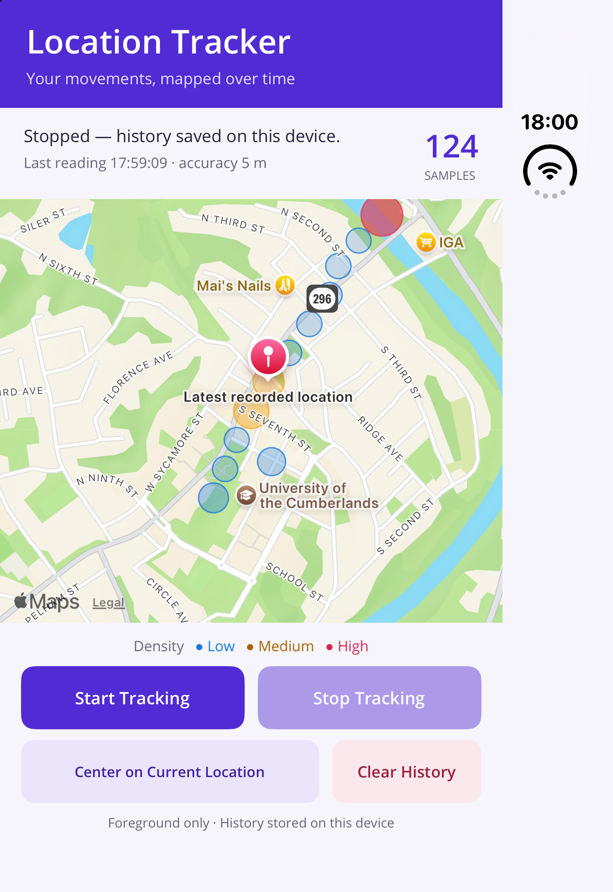

# Location Tracker — .NET MAUI

Ashish Bhanudas Mahajan · MSCS-533-A01 · University of the Cumberlands

A C# app that records foreground device locations in SQLite and visualizes their relative density using native .NET MAUI Maps circles.

[GitHub repository](https://github.com/AshishM26/MSCS-533-Project_2_AM) · [Word report](submission/MSCS533_Final_Project_LocationTracker_AM.docx) · [Validation results](submission/VALIDATION.md)

## Features and design

- Start/stop tracking, sample count, status, latest reading, map centering, and confirmed history deletion.
- Saved history and heat-map overlays reload when the app reopens. Tracking stops in the background.
- Roughly 75-meter geographic cells become blue, amber, or red according to relative sample density. Circle size and opacity increase with density; at most 400 cells are drawn.
- MVVM and dependency injection separate the MAUI UI (`LocationTracker`), portable tracking/data/aggregation services (`LocationTracker.Core`), and behavioral tests (`LocationTracker.Tests`).
- Stable .NET 10, MAUI Controls/Maps 10.0.100, and sqlite-net-pcl 1.11.285. Android and iOS targets are included; Mac Catalyst is available on macOS.

## Run locally

1. Install the .NET SDK specified in `global.json`, the MAUI workload (`dotnet workload install maui`), and VS Code with the recommended extensions in `.vscode/extensions.json` (.NET MAUI, C# Dev Kit, C#).
2. Install full Xcode with an iOS simulator runtime on macOS, or an Android SDK, JDK, and emulator.
3. iOS uses Apple Maps and needs no key. For Android maps, copy `LocationTracker/GoogleMaps.local.props.example` to `LocationTracker/GoogleMaps.local.props` and set a restricted Maps SDK for Android key in that ignored file.
4. Open `LocationTracker.slnx`, select the device in VS Code, and run with **F5**. Allow location while using the app, then tap **Start Tracking**.

Run the automated tests with `dotnet test LocationTracker.Tests/LocationTracker.Tests.csproj`.

## Permissions and privacy

Android requests coarse/fine location; iOS declares `NSLocationWhenInUseUsageDescription`. No background-location permission is requested. History stays in the app's local, unencrypted SQLite file and can be deleted with **Clear History**. Native map providers use network services. Local keys, databases, and build outputs are excluded from Git.

## Application output

Automated tests, the Android build, and runtime checks on the iOS simulator and Android emulator are recorded in [VALIDATION.md](submission/VALIDATION.md). The [Word report](submission/MSCS533_Final_Project_LocationTracker_AM.docx) is generated by `scripts/create_submission.py`.
